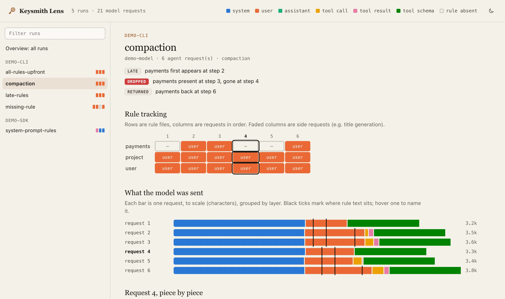

<!-- markdownlint-disable MD013 MD033 MD041 -->

<div align="center">

<picture>
  <source media="(prefers-color-scheme: dark)" srcset="docs/assets/lens-dark.webp" />
  <source media="(prefers-color-scheme: light)" srcset="docs/assets/lens-light.webp" />
  
</picture>

<p>
  
  
  
</p>

<p>
  <a href="README.md">简体中文</a> ·
  <a href="#english">English</a> ·
  <a href="https://lens.keysmithswitch.com/en/">Website</a> ·
  <a href="docs/capture-format.md">Capture format</a> ·
  <a href="LICENSE">License</a>
</p>

<h1>Keysmith Lens</h1>

<p>Replay coding-agent runs and see what the model was actually sent, step by step.</p>

</div>

## English

Your AGENTS.md, CLAUDE.md, skills and appended system prompts: did the agent send them to the model? In which layer? When did they disappear?

Keysmith Lens reads the raw requests an agent sends to the model and replays them:

- **Did each rule arrive**: an overview with one row per run and one column per rule. A filled cell is the layer where the rule first arrived (system, user, tool result, ...); a ring means it never did.
- **When rules come and go**: a rule × request grid that shows late arrivals, rules dropped after compaction, and rules that come back on a later read.
- **What the model was sent**: each request as a bar drawn to scale, split by layer, with ticks where rule text sits.
- **Piece by piece**: every segment of a request, marked when it is new since the previous one, with rule lines highlighted.
- **Flags**: never delivered, late, dropped, returned, partly present, duplicated.

Read-only. It writes one HTML file on your machine and uploads nothing.

## How delivery is decided

By the content of the rule files; nothing has to be planted in them. Each file is split into lines, and lines of 20+ characters that no other rule file shares are matched against the request. All found is delivered; some found is partial. YAML frontmatter is ignored. Requests without tool definitions (title generation and the like) are side requests: shown faded, never counted as a drop.

## Usage

Python 3.9+, no dependencies.

```sh
git clone https://github.com/Jia-Ethan/keysmith-lens.git
cd keysmith-lens

# try it on the demo runs
python3 examples/make_demo.py examples/demo
PYTHONPATH=. python3 -m keysmith_lens build examples/demo -o out/lens.html
open out/lens.html
```

For your own runs, pass run folders or folders that contain runs:

```sh
PYTHONPATH=. python3 -m keysmith_lens build path/to/runs -o out/lens.html
```

A run is a folder with `captures/NNN-*.json`, one file per request the agent sent. Rule files sit in the same folder or are listed in `fixtures.json`. See [`docs/capture-format.md`](docs/capture-format.md).

Link to a run and request with `lens.html#run=<name>&step=<n>`.

> [!IMPORTANT]
> The HTML embeds request text. If your runs contain keys, paths or private content, redact them first, or keep the file local.

## Request formats

| Format | Typical agents |
| --- | --- |
| Anthropic Messages (`/v1/messages`) | Claude Code |
| OpenAI Responses (`/v1/responses`) | OpenHands, OpenCode, Pi, Codex |
| OpenAI Chat Completions (`/v1/chat/completions`) | older OpenHands and most OpenAI-compatible tools |

## Layout

```
keysmith_lens/
  trace.py           common model: run -> request -> segment (one piece, one layer)
  adapters/wire.py   capture files -> run (three request formats)
  rules.py           find rule files, match by content, raise flags
  build.py           runs -> one HTML file
  template.html      the viewer
examples/make_demo.py  writes the demo runs (all made up)
tests/
```

Tests: `PYTHONPATH=. python3 -m unittest discover -s tests`

## The Keysmith series

[Keysmith Switch](https://keysmithswitch.com/en/) manages and deploys prompts; Keysmith Lens checks whether they actually reach the model.

## License

MIT, see [LICENSE](LICENSE).
